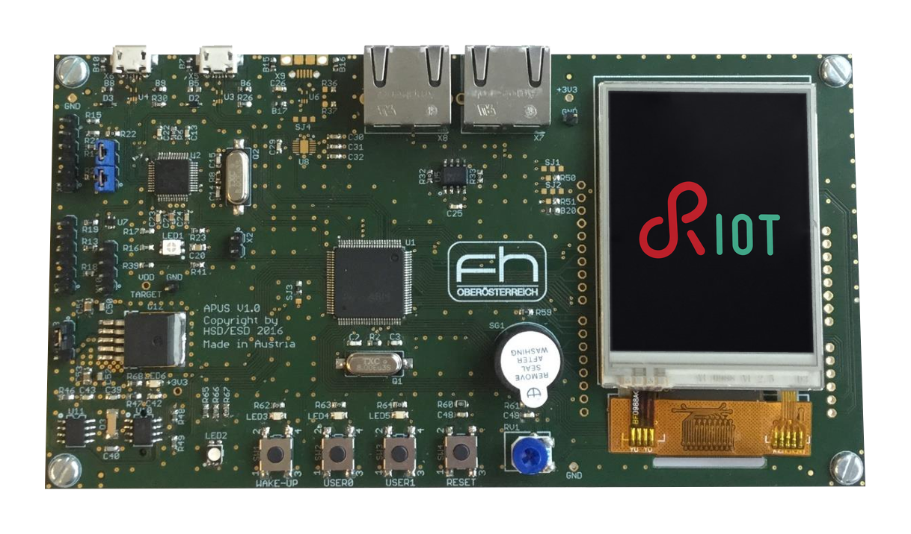
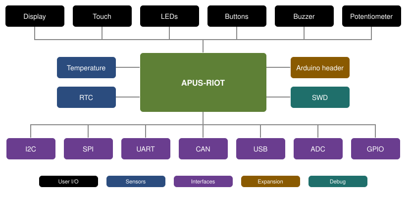

# apus-riot

RIOT board support for the **APUS board**, a development board built around the
STM32F072VBT6 (Arm Cortex-M0, 128 KB flash / 16 KB RAM).

[](https://github.com/apus-org/apus-riot/actions/workflows/build.yml)



## Overview



## Quick start

Clone RIOT and apus-riot next to each other:

```bash
git clone https://github.com/RIOT-OS/RIOT.git
git clone https://github.com/apus-org/apus-riot.git
```

Build and flash an example:

```bash
EXTERNAL_BOARD_DIRS=$PWD/apus-riot/boards make -C RIOT/examples/basic/blinky BOARD=hsd-apus flash
```

`make flash` uses RIOT's default STM32 programmer, OpenOCD.

## Requirements

RIOT `master` and the Arm GNU toolchain, or Docker with `BUILD_IN_DOCKER=1`. See the
[Getting Started guide](https://guide.riot-os.org/getting-started/installing/) for the
setup.

## Project layout

| Path | Contents |
|------|----------|
| [boards/](boards/) | board definition |
| [docs/](docs/) | documentation |
| [modules/](modules/) | drivers for the on-board chips, to be upstreamed |
| [tests/](tests/) | test applications for these drivers |

## License

Licensed under the GNU Lesser General Public License, version 2.1 ([LICENSE](LICENSE) or
<https://www.gnu.org/licenses/old-licenses/lgpl-2.1.html>).
